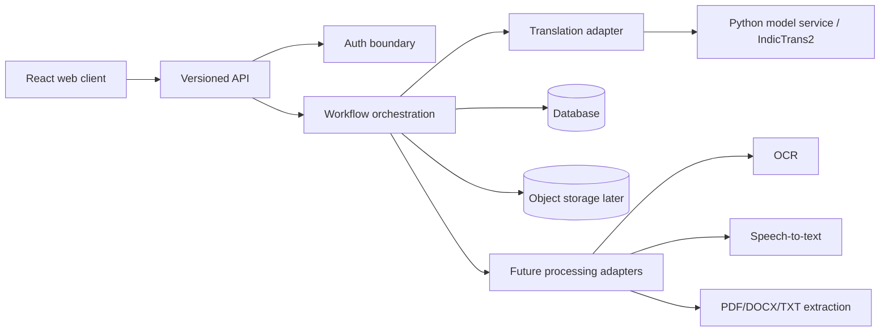

# High-Level Architecture

## Principles
Keep UI, API/orchestration, translation providers, extraction providers, persistence, storage, and authentication behind replaceable boundaries. Start simple; split deployables when workload or runtime isolation requires it.

Phase 1 should implement only the text path in design terms: UI → API → translation adapter → model service/provider → response/history. Voice, file, OCR, community, and storage components remain extension points. Heavy or long-running work should later use a job queue and status resource rather than tying up an HTTP request.

## Cross-cutting concerns
Request IDs, structured logs without raw sensitive content, metrics, validation, rate limiting, provider timeouts, retries only where safe, and explicit content-retention policy. A provider adapter must expose normalized success/error metadata without leaking vendor-specific details to the UI.
